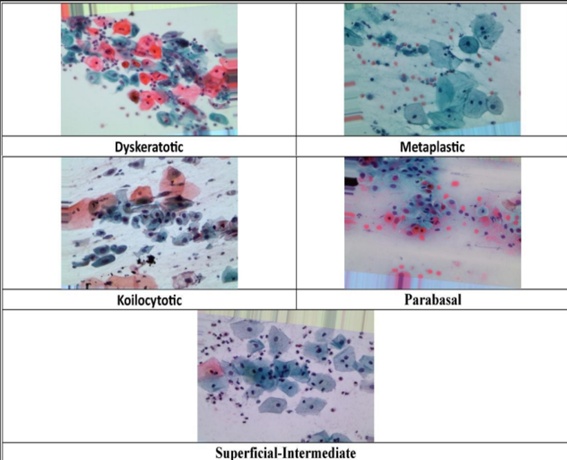

# A fusion-based deep learning framework for enhanced cervical cancer detection and classification

## Abstract

Cervical cancer is one of the leading causes of death among women, and effective diagnosis depends on early detection. Pap smear microscopy is one of the most commonly used methods for screening cervical cells. However, manual interpretation of Pap smear images is a tedious process and remains challenging due to variations in cell morphology, patterns, and shapes.

This project introduces a deep learning approach for the automatic detection and multiclass classification of cervical cells from Pap smear images. The model is trained using the SIPaKMeD dataset to classify five types of cervical cells: dyskeratotic, koilocytotic, metaplastic, parabasal, and superficial-intermediate.

Image enhancement techniques are applied to improve image quality, while a YOLO-based detection model is used to localize and extract cervical cells from the images. Five pretrained convolutional neural network (CNN) models—ResNet, AlexNet, VGG16, GoogLeNet, and InceptionV3—are employed for deep feature extraction and classification.

Two fusion strategies are implemented: **feature-level fusion** and **decision-level fusion**. In feature-level fusion, features extracted from the five CNN models are combined using an attention-guided fusion mechanism and passed to a multilayer perceptron (MLP) classifier. In decision-level fusion, the prediction probabilities generated by the five CNN models are combined to determine the final cervical cell classification.

The performance of the proposed framework is evaluated using accuracy, precision, recall, F1-score, and AUC-ROC. Experimental results on the SIPaKMeD dataset achieve an accuracy of **99.21% with feature-level fusion** and **99.61% with decision-level fusion**.

Additionally, **Real-Time Pap Smear Images (Clinic Patients)** are used for independent testing to evaluate the model's performance on real-world Pap smear images beyond the training dataset.

## Key Features

- Automated cervical cell detection using YOLO.
- Image enhancement and preprocessing.
- Five-class cervical cell classification.
- Deep feature extraction using five pretrained CNN architectures.
- Attention-guided feature-level fusion.
- Probability-based decision-level fusion.
- Evaluation using multiple classification metrics.
- Independent testing using **Real-Time Pap Smear Images (Clinic Patients)**.

## Technologies Used

- Python
- Deep Learning
- Convolutional Neural Networks (CNNs)
- YOLO
- ResNet
- AlexNet
- VGG16
- GoogLeNet
- InceptionV3
- Attention Mechanism
- Multilayer Perceptron (MLP)
- Image Processing

## 📂 Dataset

## Training Dataset

Existing public cervical cell image datasets will be used for training.

Datasets:

- SIPaKMeD Dataset
- Herlev Dataset

  This is a SIPaKMeD dataset that we used to train our model
  

- **Training and evaluation dataset:** SIPaKMeD.
- **Independent testing dataset:** **Real-Time Pap Smear Images (Clinic Patients)**.

## Results

| Fusion Method | Accuracy |
|---|---:|
| Feature-Level Fusion | 99.21% |
| Decision-Level Fusion | 99.61% |

**Note:** The reported accuracy values are experimental results on the evaluated dataset. Independent real-world performance should be assessed separately using clinic-captured images.

